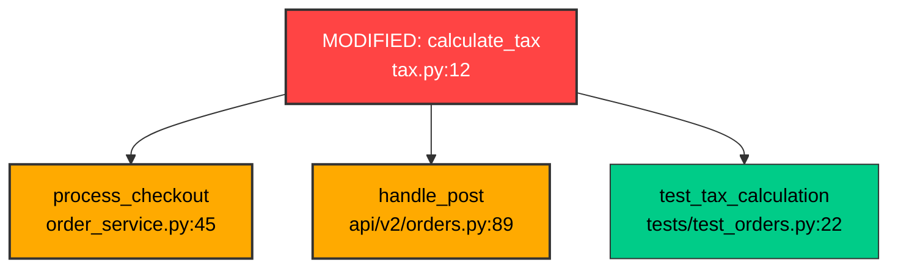

<div align="center">

```
  ██████╗ ██████╗ ██╗███████╗███╗   ███╗
  ██╔══██╗██╔══██╗██║██╔════╝████╗ ████║
  ██████╔╝██████╔╝██║███████╗██╔████╔██║
  ██╔═══╝ ██╔══██╗██║╚════██║██║╚██╔╝██║
  ██║     ██║  ██║██║███████║██║ ╚═╝ ██║
  ╚═╝     ╚═╝  ╚═╝╚═╝╚══════╝╚═╝     ╚═╝
```

### 💎 Topological Blast Radius & Invariant Radar for AI-Generated Code

*Know what the AI just broke across your entire repository before you commit.*

[](https://pypi.org/project/prism-radar/)
[](https://github.com/shenald-dev/prism/releases)
[](https://www.python.org/downloads/)
[](LICENSE)
[](https://github.com/shenald-dev/prism/actions)
[](#architecture)
[](#quick-start)

---

[The Problem](#-the-problem) •
[Key Highlights](#-key-highlights) •
[Quick Start](#-quick-start) •
[Terminal UI](#-terminal-ui) •
[Visual DAG Diagrams](#-visual-blast-diagrams) •
[CLI Commands](#-cli-commands) •
[Agent Loop Mode](#-agent--llm-loop-mode) •
[CI / CD Enforcement](#-ci--github-actions-enforcement) •
[Architecture](#-architecture)

---

</div>

## 💥 The Problem

In the era of vibe coding and autonomous AI agents (**Cursor, Claude Code, Copilot, Cline, Aider**), AI writes code at 1,000 WPM.

**However, LLMs suffer from severe tunnel vision:**
- An AI refactors `authenticate_user(user_id, token, tenant_id=None)` to require `org_id` as a second parameter.
- Or an AI converts `fetch_user_profile()` to an `async def` function, forgetting to update 15 caller sites with `await`.
- The AI runs its isolated unit test in `test_auth.py`, reports *"Refactoring complete!"*, and stops.
- Downstream in `billing/webhook.py`, `api/v1/sessions.py`, and `workers/sync.ts`, 12 callers are now silently broken with:
  ```text
  TypeError: authenticate_user() missing 1 required positional argument: 'org_id'
  RuntimeWarning: coroutine 'fetch_user_profile' was never awaited
  ```

Traditional typecheckers (mypy, tsc) require strict types everywhere or take seconds to recompile your whole project. Unit tests only catch downstream breakage if you already wrote tests for every transitive caller.

**`prism` is a zero-latency topological radar.** It scans your uncommitted git diff (`git diff HEAD`) or branch diff, builds an in-memory dependency graph, traces the ripple shockwave up to N hops deep, audits contract invariants and async boundaries on callers, visualizes blast graphs, and auto-patches broken callsites—all in **<50ms**.

---

## ⚡ Key Highlights

- 🌊 **Topological Ripple Shockwave:** Computes the multi-hop transitive caller tree of every symbol touched in your git working tree.
- ⚡ **Async & Coroutine Invariant Radar:** Flags unawaited coroutines (`CRITICAL`) and awaiting synchronous functions (`HIGH`) across Python and TypeScript/JavaScript.
- 🛡️ **Advanced Contract Invariant Checking:** Flags missing required arguments, excess positional parameters, unexpected keyword arguments, positional-only violations (`/`), duplicate bindings, and dataclass signatures across Python 3.8–3.12 and TypeScript/JavaScript.
- 🗺️ **Visual Blast Diagrams (Mermaid.js & Graphviz DOT):** Generates interactive Mermaid.js flowcharts and DOT graphs of the blast radius with color-coded risk highlighting.
- 🩹 **Automated Call-Site Auto-Patching (`prism fix`):** Synthesizes surgical unified diffs or directly applies fixes to callers (e.g. inserting `await`) with zero manual effort.
- 👀 **Live Vibe-Coding Watcher (`prism watch`):** Sub-second filesystem daemon monitoring working tree changes in real time as AI edits your code.
- 🧪 **Intelligent Test Impact Radar:** Pinpoints exact test files and test functions that directly or transitively cover modified code, flags untested modified symbols, and runs only affected tests with one command.
- 🤖 **Agent Remediation Prompt Generator (`prism explain`):** Synthesizes high-density, zero-hallucination prompt context and exact code fixes for autonomous coding agents (Claude Code, Cursor, Copilot, Aider, Devin).
- 📊 **Multi-Format Enterprise Reporting:** Emits Rich terminal UI, machine-readable JSON, GitHub Flavored Markdown (`$GITHUB_STEP_SUMMARY`), Mermaid, DOT, or SARIF 2.1.0 for GitHub Code Scanning inline PR annotations.
- 🔀 **Revision & CI Diffing:** Analyze uncommitted changes, staged changes (`--staged`), commits (`--commit`), or base branches (`--base origin/main`).
- ⚡ **Sub-50ms Zero-Config Engine:** Pure AST visitor with zero heavy daemon overhead. Runs instantaneously on commit hooks.

---

## 💻 Terminal UI

When you run `prism scan` after an AI edits your code:

```text
┌─────────────────────────────────────────────────────────────────────────────┐
│     ____  ____  ___ ____  __  __                                            │
│    |  _ \|  _ \|_ _/ ___||  \/  |                                           │
│    | |_) | |_) || |\___ \| |\/| |                                           │
│    |  __/|  _ < | | ___) | |  | |                                           │
│    |_|   |_| \_\___|____/|_|  |_|                                           │
│    💎 Topological Blast Radius & Invariant Radar • Zero Bloat               │
└─────────────────────────────────────────────────────────────────────────────┘

📡 Topological Ripple Shockwave:

💎 MODIFIED: calculate_tax (tax.py:12)
  > def calculate_tax(amount, rate, jurisdiction)
├──  ⚠️ BROKEN CONTRACT  order_service.py::process_checkout (order_service.py:45)
│     > Missing 1 required argument(s): 'jurisdiction'.
│   └── [L2 Transitive] checkout_worker.py::run_job (checkout_worker.py:18)
├── [🧪 Test Caller] tests/test_orders.py::test_tax_calculation (tests/test_orders.py:22)
└──  ⚠️ BROKEN CONTRACT  api/v2/orders.py::handle_post (api/v2/orders.py:89)
      > Missing 1 required argument(s): 'jurisdiction'.

🚨 Contract Violations & Signature Mismatches (2)
┌────────────┬──────────────────────────────┬──────────────────────────────┬────────────────────────────────┐
│    Sev     │ Caller Location              │ Contract Violation Reason    │ Suggested Fix                  │
├────────────┼──────────────────────────────┼──────────────────────────────┼────────────────────────────────┤
│  CRITICAL  │ order_service.py:45          │ Missing 1 required arg...    │ Pass 'jurisdiction' parameter  │
│  CRITICAL  │ api/v2/orders.py:89          │ Missing 1 required arg...    │ Pass 'jurisdiction' parameter  │
└────────────┴──────────────────────────────┴──────────────────────────────┴────────────────────────────────┘

┌─────────────────────────── 🧪 TEST IMPACT RADAR ────────────────────────────┐
│  • Impacted Test Files: 1                                                   │
│  • Impacted Test Cases: 1                                                   │
│  • Recommended Run: pytest tests/test_orders.py                             │
└─────────────────────────────────────────────────────────────────────────────┘

┌─────────────────── 📊 TOPOLOGICAL BLAST RADAR TELEMETRY ────────────────────┐
│  Blast Impact Score: 85/100 [CRITICAL]                                      │
│  Assessment: 🚨 CRITICAL (Broken Contracts Detected)                        │
│  • Modified Symbols: 1    • Direct Callers: 2    • Transitive: 1            │
│  • Broken Contracts: 2    • Impacted Tests: 1                               │
│  Analyzed 24 files in 0.038s.                                               │
└─────────────────────────────────────────────────────────────────────────────┘
```

---

## 🗺️ Visual Blast Diagrams

Export topological DAG diagrams directly into Mermaid.js or Graphviz DOT format:

```bash
prism visual --format mermaid
```



---

## 🚀 Quick Start

### Installation

Install directly via `pip`:

```bash
pip install prism-radar
```

Or run via `pipx` / `uv`:

```bash
pipx install prism-radar
# or
uv tool install prism-radar
```

---

## 🛠️ CLI Commands

### 1. `prism scan` (Core Blast & Contract Radar)

Scan your current git working tree (unstaged + staged changes):

```bash
prism scan
```

Scan against a base branch (e.g. in PRs or feature branches):

```bash
prism scan --base origin/main
```

Scan staged changes only:

```bash
prism scan --staged
```

Run in strict mode (fails with exit code `1` if broken contracts or high risk are found):

```bash
prism scan --strict
```

Export results as Mermaid.js or Graphviz DOT:

```bash
prism scan --format mermaid
prism scan --format dot
```

Export results as SARIF 2.1.0 for GitHub Code Scanning:

```bash
prism scan --format sarif -o results.sarif
```

Export results as GitHub Flavored Markdown for PR comments:

```bash
prism scan --format markdown
```

### 2. `prism visual` (Interactive DAG Diagram Generator)

Generate visual diagrams of the blast shockwave:

```bash
# Print Mermaid diagram
prism visual --format mermaid

# Save Graphviz DOT diagram to file
prism visual --format dot -o blast-graph.dot
```

### 3. `prism fix` (Automated Call-site Auto-Patching)

Inspect proposed caller fixes for broken contracts (unawaited coroutines, missing arguments):

```bash
prism fix
```

Save unified diff patch to a file:

```bash
prism fix --patch fix.patch
```

Automatically apply fixes directly into caller source files:

```bash
prism fix --apply
```

### 4. `prism watch` (Real-Time Vibe-Coding Radar)

Run a continuous live watcher daemon that re-scans the repository as AI edits code:

```bash
prism watch
prism watch --interval 0.5
```

### 5. `prism hook install` (Git Pre-Commit Hook)

Install an instant native Git pre-commit hook into `.git/hooks/pre-commit`:

```bash
prism hook install
```

### 6. `prism ci init` (GitHub Actions CI Setup)

Bootstrap a ready-to-run GitHub Actions CI workflow at `.github/workflows/prism-radar.yml`:

```bash
prism ci init
```

### 7. `prism test-impact` (Smart Test Selection)

Identify exactly which tests are impacted by your current changes and find coverage gaps:

```bash
prism test-impact
```

Automatically execute only the impacted tests:

```bash
prism test-impact --run
```

### 8. `prism explain` (AI Agent Self-Healing Context)

Generate high-density diagnostic context and remediation instructions ready to pipe into an AI coding agent:

```bash
prism explain
```

### 9. `prism init` (Project Configuration)

Initialize a `prism.toml` file with sensible defaults:

```bash
prism init
```

---

## 🤖 Agent / LLM Loop Mode

If you run autonomous coding loops (**Claude Code, Cursor Agent, Copilot Workspace, Aider, Devin**), use `prism` as your invariant guardrail:

```bash
# Provide structured context to agent when contracts break
prism explain | your-agent-fixer

# Or auto-apply deterministic callsite fixes
prism fix --apply
```

Or pipe structured JSON:

```bash
prism scan --json | your-agent-fixer
```

Sample JSON output:

```json
{
  "impact_score": 85,
  "risk_level": "CRITICAL",
  "metrics": {
    "modified_symbols": 1,
    "direct_callers": 2,
    "transitive_callers": 1,
    "total_affected_files": 4,
    "contract_violations": 2
  },
  "violations": [
    {
      "callee_name": "fetch_user",
      "caller_file": "order_service.py",
      "caller_line": 45,
      "severity": "CRITICAL",
      "reason": "Unawaited coroutine call: 'fetch_user' is an async function but called synchronously without await",
      "snippet": "fetch_user(order.user_id)",
      "suggested_fix": "Add 'await' prefix to coroutine invocation: await fetch_user(order.user_id)"
    }
  ],
  "test_impact": {
    "impacted_test_files": ["tests/test_orders.py"],
    "impacted_test_cases": ["tests/test_orders.py::test_user_fetch"],
    "recommended_command": "pytest tests/test_orders.py"
  }
}
```

---

## 🛡️ CI & GitHub Actions Enforcement

### One-Command Setup

```bash
prism ci init
```

This generates `.github/workflows/prism-radar.yml`:

```yaml
name: PRISM Blast Radius Radar

on:
  pull_request:
    branches: [main, master]
  push:
    branches: [main, master]

jobs:
  prism-radar:
    name: Blast Radius & Contract Radar
    runs-on: ubuntu-latest
    steps:
      - name: Checkout Code
        uses: actions/checkout@v4
        with:
          fetch-depth: 0

      - name: Set up Python
        uses: actions/setup-python@v5
        with:
          python-version: "3.11"

      - name: Install PRISM
        run: |
          pip install git+https://github.com/shenald-dev/prism.git

      - name: Run PRISM Blast Radius Radar
        run: |
          prism scan --base origin/main --format sarif --output prism.sarif --format markdown > prism-summary.md
          cat prism-summary.md >> $GITHUB_STEP_SUMMARY
        continue-on-error: true

      - name: Upload SARIF to GitHub Code Scanning
        uses: github/codeql-action/upload-sarif@v3
        if: always()
        with:
          sarif_file: prism.sarif
          category: prism-radar
```

---

## ⚙️ Configuration (`prism.toml`)

Customize PRISM's analysis behavior with an optional `prism.toml` or `pyproject.toml`:

```toml
[prism]
max_depth = 6
strict = false
fail_on = "CRITICAL"            # "CRITICAL", "ELEVATED", "MODERATE", or "ANY"
ignore_symbols = ["__repr__", "__str__", "__init__"]
include_tests = true
default_format = "terminal"     # "terminal", "json", "sarif", "markdown", "mermaid", "dot"
```

---

## ⚙️ Architecture

```
                       ┌──────────────────────┐
                       │  Git Diff Workspace  │
                       └──────────┬───────────┘
                                  │ (modified line spans)
                                  ▼
┌──────────────────┐    ┌─────────────────────┐    ┌──────────────────┐
│  Python AST      │───▶│  Symbol Extraction  │◀───│  JS / TS Lexer   │
│  Visitor Engine  │    │  & Parameter Schema │    │  Parser Engine   │
└────────┬─────────┘    └──────────┬──────────┘    └────────┬─────────┘
         │                         │                        │
         ▼                         ▼                        ▼
┌──────────────────┐    ┌─────────────────────┐    ┌──────────────────┐
│  Import Visitor  │───▶│  Topological Graph  │◀───│ Test Impact Radar│
│  Alias Resolver  │    │  Transitive Callers │    │ Coverage Gaps    │
└──────────────────┘    └──────────┬──────────┘    └──────────────────┘
                                   │
                                   ▼
                        ┌─────────────────────┐
                        │  Contract Invariant │
                        │  & Async Auditor    │
                        └──────────┬──────────┘
                                   │
      ┌────────────────────────────┼────────────────────────────┐
      ▼                            ▼                            ▼
[Rich Terminal Radar]     [Visual Mermaid / DOT]     [Auto-Patch Remediation]
```

1. **Diff Intersector:** `git diff` computes precise line ranges for uncommitted, staged, commit, or branch diffs.
2. **AST Symbol Extractor:** Full structural AST visitor captures functions, methods, async status, classes, dataclasses, positional-only, keyword-only, variadic, and default parameters.
3. **Import Resolver:** Resolves imported modules and aliases to eliminate cross-module name collisions.
4. **Topological Graph:** Computes the directed acyclic graph (DAG) of callers with cycle detection and centrality scoring.
5. **Contract Invariant & Async Auditor:** Verifies parameter counts, keyword alignment, positional-only rules, unawaited coroutines, and invalid awaits.
6. **Visual & Auto-Patch Engines:** Renders Mermaid/DOT DAGs and synthesizes surgical call-site fixes.

---

## 🤝 Contributing

Contributions are welcome! Please open an issue or PR on [GitHub](https://github.com/shenald-dev/prism).

```bash
git clone https://github.com/shenald-dev/prism.git
cd prism
pip install -e ".[dev]"
pytest
ruff check .
```

---

## 📜 License

MIT License. Designed and built with ❤️ by [shenald-dev](https://github.com/shenald-dev).
